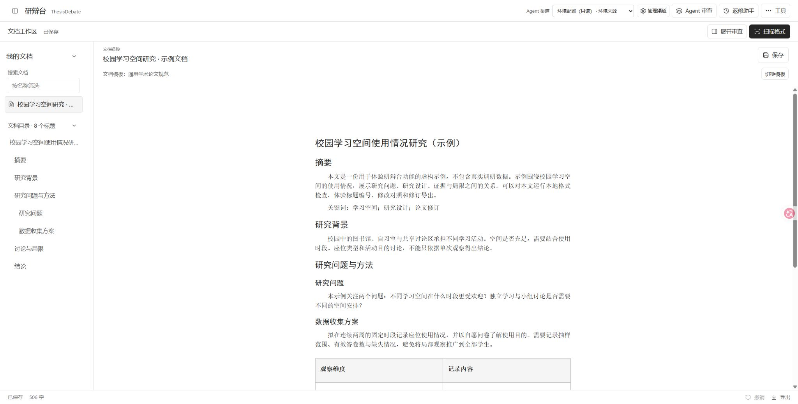
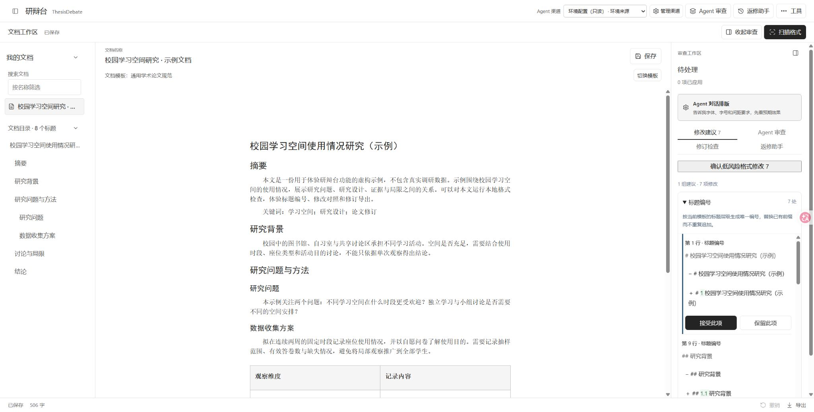
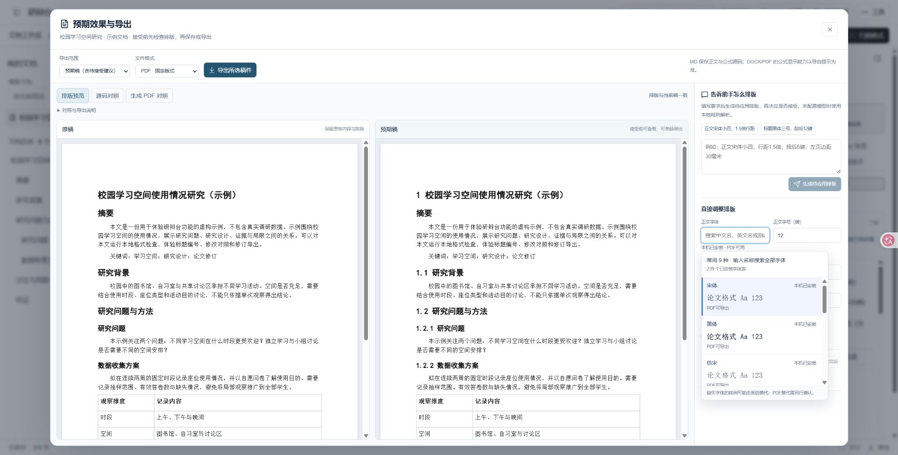
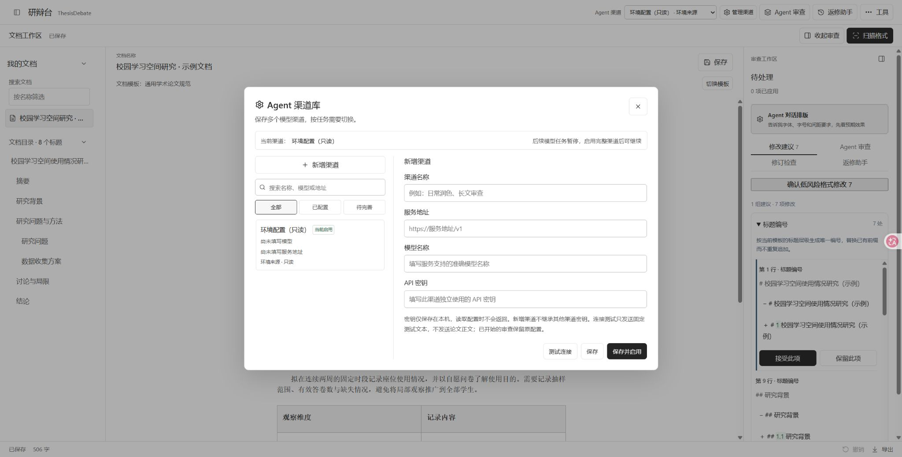
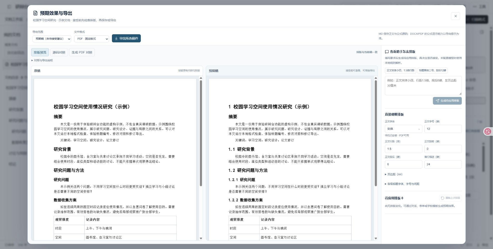

# 研辩台 ThesisDebate

**把阅读、审查、修订与导出，放进同一个论文审查与修订工作台。**

研辩台是一款面向学生、研究者与文档写作者的本地桌面应用。围绕一份文档，可以完成内容编辑、格式检查、多角色审查、修改核验与成果导出；每条建议都可以查看出处、决定是否接受，并在需要时撤销。

[下载 Windows 首版 v0.0.1](https://github.com/GYF-66/thesisdebate/releases/tag/v0.0.1) · [提交问题或建议](https://github.com/GYF-66/thesisdebate/issues/new/choose) · [更新记录](CHANGELOG.md)

> 首次启动是空白工作区。下方截图来自本次发布的可执行文件，使用仓库中的示例文档；模型服务需要自行配置。

## 功能一览

| 功能 | 可以做什么 |
| --- | --- |
| 文档工作台 | 新建或导入 Markdown、TXT、DOCX；富文本编辑、标题目录、表格与公式预览，自动保存并恢复上次文档。 |
| 格式检查与修订 | 按规则检查标题编号、标题间距、行尾空白、参考文献编号等；同类建议分组，支持逐项或批量接受、拒绝及撤销。 |
| 多角色 Agent 审查 | 配置兼容模型服务后，从多个角色检查论证与证据，查看任务进度、来源定位和历史版本，人工确认修改。 |
| 模型渠道库 | 保存多个服务配置，搜索、筛选、测试连接和切换当前渠道；已开始的任务保留自己的配置快照。 |
| 排版与字体 | 设置字体、字号、行距、段距、页边距和六级标题；检索本机字体，预览排版并逐项确认调整。 |
| 资料与返修辅助 | 导入资料、按关键词查找出处和摘录；整理导师任务、批注与答复，生成提交检查单和答辩准备问题。 |
| 学校格式模板 | 选择文档类型，导入 TXT、Markdown 或带文字层的 PDF 规范，提取规则、处理冲突并人工确认。 |
| 成果导出 | 生成 Markdown、DOCX 与分页 PDF，选择原稿、预期稿或当前稿；提供修改对照和 DOCX 结构保护。 |

## 功能截图

### 文档工作台

正文、目录、修改建议与排版入口集中呈现，适合边阅读边修订。



### 格式建议与修改对照

同类修改集中查看，逐项确认建议与原文之间的关系。



### 排版与字体

检索本机字体，并在导出前检查可用字体和替代情况。



### 模型渠道设置

模型服务可自行配置；未配置时，本地编辑、格式检查与导出仍可使用。



### 导出文档

按用途选择文件格式、导出范围与 DOCX 结构保护方式。



## 下载与开始使用

1. 打开 [v0.0.1 首版发布页](https://github.com/GYF-66/thesisdebate/releases/tag/v0.0.1)，下载附件 `研辩台_0.0.1.exe`。
2. 在 Windows x64 上运行。程序已内置 Python、后端与页面，无需安装 Node.js 或启动终端；系统需要具备 Microsoft Edge WebView2 Runtime。
3. 新建文档，或导入 `.md`、`.txt`、`.docx` 文件。也可以使用 [示例论文](examples/论文示例.md) 体验本地格式检查。
4. 打开格式检查，查看修改建议，确认后导出修订副本。需要多角色审查时，再通过顶部的渠道管理设置模型服务。

首版文件大小为 **51,883,624 字节（约 49.48 MiB）**，SHA-256：

```text
b1aff790b7e9e073f8bd49c6e4a2929b85d252fff952d9e2e830fecc539b4bca
```

在 PowerShell 中可核对下载文件：

```powershell
Get-FileHash -Algorithm SHA256 './研辩台_0.0.1.exe'
```

## 一次完整的修订流程

1. **导入与编辑**：打开文档，确认正文与标题目录，修改内容并保存。
2. **本地格式检查**：先运行确定性规则，检查标题、空白与编号等可直接验证的问题。
3. **模型审查（可选）**：配置服务后运行多角色审查，检查建议中的证据与原文定位。
4. **确认修改**：通过差异与修改核验，逐条接受、保留原文或撤销；格式调整需要明确应用。
5. **预览与导出**：检查分页、字体和导出范围，保存 DOCX、PDF 或 Markdown 副本。

## 模型配置与本地数据

顶部的 **Agent 渠道** 与 **管理 Agent 渠道** 提供服务地址、模型和密钥设置，以及连接测试和渠道切换。程序不会提供公共密钥，模型调用费用由所使用的服务决定。没有可用渠道时，不会生成虚构的模型审查结果。

桌面版的数据保存在 `%LOCALAPPDATA%/ThesisDebate/`，包括 SQLite 文档数据和本地渠道配置；Windows 渠道密钥使用系统 DPAPI 保护。更新或移动 EXE 不会清空这个目录。备份时请先关闭程序，再复制整个数据目录。

本地编辑和规则检查无需模型服务。运行模型审查会将相应文档内容发送到选定服务；主动触发文献核验时，会查询 Crossref，必要时按 DOI 查询 OpenAlex。

## 当前版本的边界

- **正文导入支持 Markdown、TXT、DOCX**；论文 PDF 正文导入、扫描件 OCR 尚未实现。资料库和规范工具可提取带文字层 PDF 的文本。
- DOCX 导入会提取可编辑内容并提示兼容性。结构保护导出只回写可安全映射的普通文字；复杂结构修改可能被阻止。重新生成可编辑副本时，图片、域、批注等对象可能无法还原，界面会提示。
- 公式可在编辑器中预览；重新生成 DOCX/PDF 时保留 LaTeX 源码，不承诺公式字形排版。原 DOCX 的受保护公式部件可保留。
- 资料问答目前是本地关键词检索与摘录，文献核验检查元数据是否匹配，均不等同于证明某个学术结论。
- 当前以本地单用户工作区为主；多人实时协作、查重检测与真实 TeX 编译不属于首版能力。

## 从源码运行

源码与本次发布的 EXE 来自同一构建源。发布版本以 **v0.0.1** 为准，部分内部开发包的版本字段暂沿用 `0.1.0`。开发环境需要 Python 3.12、Node.js 20.9 或更高版本，以及 npm。

在项目根目录安装依赖：

```powershell
py -3.12 -m venv backend/.venv
./backend/.venv/Scripts/python.exe -m pip install -r backend/requirements.txt
cd frontend
npm ci
cd ..
```

分别在两个终端从项目根目录启动：

```powershell
./START_REVIEW.ps1 -Mode backend
```

```powershell
./START_REVIEW.ps1 -Mode frontend
```

打开 `http://localhost:3001`；API 为 `http://localhost:8001`。启动器会配置前端 API 地址。可选的 Docker Compose 服务属于后续基础设施预留，本地工作区使用 SQLite，无需先启动它们。

### 验证与打包

```powershell
./backend/.venv/Scripts/python.exe -m pip install -r backend/requirements-test.txt
cd backend
./.venv/Scripts/python.exe -m unittest discover -s tests -v
cd ../frontend
npm run lint
node --test
cd ..
```

在 Windows x64 上构建桌面版：

```powershell
./backend/.venv/Scripts/python.exe -m pip install -r desktop/requirements-build.txt
./backend/.venv/Scripts/python.exe -m pip install fonttools==4.68.0
./backend/.venv/Scripts/python.exe desktop/build_windows.py
```

脚本检查依赖版本、构建前端静态资源，再生成 `desktop/dist/研辩台.exe`。详细说明见 [桌面构建文档](desktop/README.md)。

## 项目结构

```text
frontend/          Next.js、TypeScript 与文档编辑界面
backend/           FastAPI、SQLite、规则检查、审查与导出
desktop/           pywebview 桌面入口及 Windows 打包脚本
docs/screenshots/  首版真实界面截图
examples/          可导入的示例文档
.github/           中文问题反馈与功能建议模板
START_REVIEW.ps1   本地开发启动器
```

## 问题反馈与参与

欢迎通过 [GitHub Issues](https://github.com/GYF-66/thesisdebate/issues/new/choose) 提交 Bug、功能建议和使用体验。请附上软件版本、操作系统、复现步骤与截图；文档兼容性问题可以提供不含私人信息的最小示例。

参与开发请阅读 [贡献说明](CONTRIBUTING.md)。首版会持续完善文档兼容、排版体验和审查流程。

## 友情链接

[LINUX DO](https://linux.do/)
