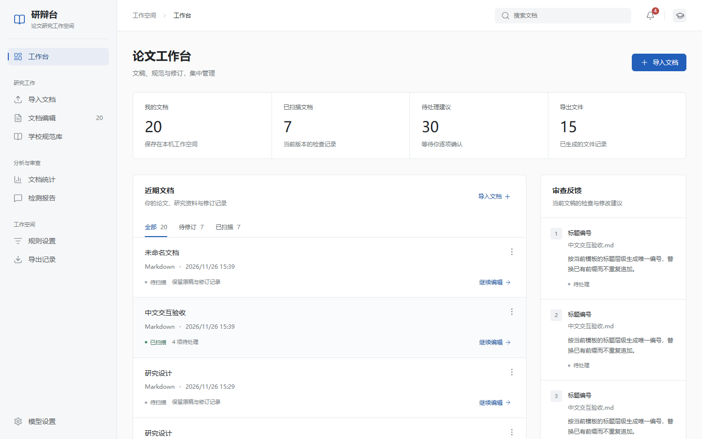
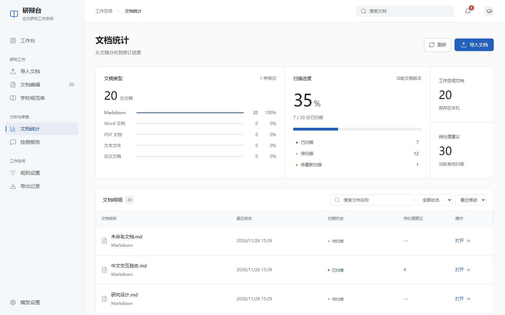
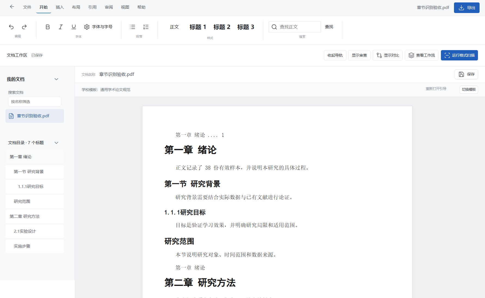

# 研辩台 ThesisDebate

中文论文审查与修订工作台。导入文档，核对章节目录，运行格式检查，确认修改并导出。Windows 单文件内置页面、Python 和后端，本地编辑、格式检查与排版无需模型服务。

[下载 Windows v0.0.3](https://github.com/GYF-66/thesisdebate/releases/tag/v0.0.3) · [更新记录](CHANGELOG.md) · [反馈问题](https://github.com/GYF-66/thesisdebate/issues/new/choose) · [发布验证记录](docs/release-v0.0.3.json)

## v0.0.3 更新

- 统一中文浅色八页工作台、真实文档统计、学校规范和导出记录。
- 修复空编号列表导入崩溃，保持空项、嵌套结构及历史富文档。
- 支持文字版 PDF 正文导入，自动识别章节、书签及明显大字号短标题，加入分级目录；点击定位，保存后恢复。
- 修复公式覆盖选中文本、切换文档后撤销历史污染当前稿的问题。

以下截图来自实际页面及 Windows EXE 的验收文档。

## 下载与开始使用

1. 在 [v0.0.3 发布页](https://github.com/GYF-66/thesisdebate/releases/tag/v0.0.3) 下载 ThesisDebate_0.0.3.exe。
2. 使用 Windows x64 和 Microsoft Edge WebView2 Runtime，双击启动，无需单独安装 Python 或 Node.js。
3. 首次显示空白工作区。新建文档，或从「导入文档」选择 Markdown、TXT、DOCX、带文字层 PDF。
4. 在「文档编辑」核对正文及左侧目录，运行格式扫描，逐项接受、保留或撤销建议。
5. 核对学校模板排版后导出 Markdown、DOCX 或 PDF；导出记录可再次下载。

文件大小 **54,324,057 字节（约 51.81 MiB）**，SHA-256：

    0c347b8cefaf78cfd131db8c16bea38df702ff8e5a6ec1374b828b5d03d7e639

PowerShell 校验命令：

    Get-FileHash -Algorithm SHA256 './ThesisDebate_0.0.3.exe'

## 功能

| 页面 | 功能 |
| --- | --- |
| 工作台 | 最近文稿与真实工作区概况。 |
| 导入文档 | Markdown、TXT、DOCX、文字版 PDF 正文导入。 |
| 文档统计 | 类型分布、扫描覆盖率、状态筛选与真实计数。 |
| 检测报告 | 规则问题、原文定位、修订状态和建议处理。 |
| 文档编辑 | 富文本、章节目录、表格、公式、自动保存、模板排版与审查入口。 |
| 规则设置 | 检查规则开关和持久化配置。 |
| 学校规范库 | 上传 DOCX、PDF 或 JSON 规范，核对识别参数并选用。 |
| 导出记录 | Markdown、DOCX、PDF 和历史批量下载。 |

模型服务可在 Agent 设置中填写现有兼容渠道的地址、模型和密钥；未配置时本地编辑、扫描及导出仍可用，不生成模拟审查意见。运行模型审查会发送对应文稿至选定服务。

## PDF 与文档兼容

PDF 识别结合中文章／节、多级编号、英文 Chapter／Section、真实书签和文字字号。识别结果成为可编辑标题，随文档保存；可通过编辑器工具栏调整标题级别。重复页眉和原 PDF 的点线目录行保留正文，不额外加入导航。

- 扫描／图片 PDF 请先 OCR，当前不内置 OCR；加密、损坏和超限文件会显示具体提示。
- 自动目录为左侧导航，当前不自动插入带页码的打印目录。
- 复杂分栏、表格、图片、公式及非常规标题需核对；导入不承诺像素级保留 PDF 原版式。
- DOCX 导入与导出以可编辑内容为主；原始图片、域、批注等复杂对象需对照原稿核验。
- 重新生成 DOCX／PDF 的公式保留 LaTeX 源码；本地规则、模型意见和文献元数据均需人工判断。

## 本地数据与更新

数据位于 %LOCALAPPDATA%/ThesisDebate/，包括 SQLite 文档和本地配置。更新 EXE 不清空工作区；更新前保存并关闭旧窗口。备份请在退出后复制整个数据目录。

## 从源码运行

发布以 **v0.0.3** 标签为准，内部包版本沿用开发标记。环境：Windows x64、Python 3.12、Node.js 24 与 npm。源码包对应当前提交；发布 EXE 来自已验证候选，仓库仅适配 frontend/ 资源路径和测试依赖清单。

在项目根目录执行：

    py -3.12 -m venv backend/.venv
    ./backend/.venv/Scripts/python.exe -m pip install -r backend/requirements.txt
    cd frontend
    npm ci
    cd ..

分别在两个终端运行：

    ./START_REVIEW.ps1 -Mode backend
    ./START_REVIEW.ps1 -Mode frontend

前端 http://localhost:3001，API http://localhost:8001。本地使用 SQLite，Docker Compose 为可选基础设施。

### 验证与打包

    ./backend/.venv/Scripts/python.exe -m pip install -r backend/requirements-test.txt
    cd backend
    ./.venv/Scripts/python.exe -m unittest discover -s tests -v
    cd ../frontend
    npm run lint
    node --test
    npm run build
    cd ..
    ./backend/.venv/Scripts/python.exe -m pip install -r desktop/requirements-build.txt
    ./backend/.venv/Scripts/python.exe desktop/build_windows.py

输出 desktop/dist/研辩台.exe，详见 [桌面构建](desktop/README.md)。

## 项目结构

    frontend/          Next.js、TypeScript、文档界面与前端回归
    backend/           FastAPI、SQLite、导入导出、规则与审查
    desktop/           原生窗口与 Windows 打包
    docs/              版本验证与截图
    examples/          示例文档
    START_REVIEW.ps1   本地开发启动器

[历史 v0.0.2 指南](docs/FIRST_USE.md) · [贡献说明](CONTRIBUTING.md) · [GitHub Issues](https://github.com/GYF-66/thesisdebate/issues)

视觉整理参考 Unslop craft guidance，Damir Sokolovsky (@heydamir)，CC BY 4.0。
